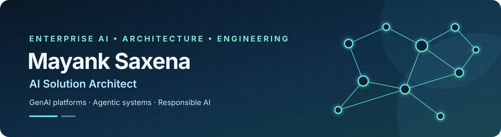
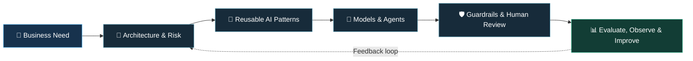

### AI Solution Architect · Enterprise GenAI · Agentic AI

**Turning emerging AI capabilities into secure, governed, reusable enterprise solutions.**

  
  
  

---

## 👋 About Me

I'm an **AI Solution Architect** with **15+ years of technology experience**, spanning software engineering, solution architecture, Generative AI, and agentic systems.

I work at the intersection of **architecture, hands-on engineering, and enterprise governance**—helping turn business needs into AI solutions that are practical to operate, secure by design, observable, cost-aware, and reusable across teams.

My focus is not just on making an AI demo work. It's on designing the **platforms, patterns, and guardrails** that help teams take AI from experimentation toward production with confidence. My experience spans financial services, technology, automotive, industrial manufacturing, and agriculture.

---

## 🧭 What I Do

<table>
  <tr>
    <td width="50%" valign="top">

### 🏗️ Enterprise AI Architecture
Reference architectures, reusable blueprints, model-access patterns, API integration, and scalable AI platforms.

</td>
    <td width="50%" valign="top">

### 🤖 Agentic AI Systems
Agent orchestration, tool use, memory, multi-step workflows, and human-in-the-loop review.

</td>
  </tr>
  <tr>
    <td width="50%" valign="top">

### 📚 RAG & Knowledge Assistants
Grounded question answering, retrieval pipelines, vector search, and enterprise knowledge integration.

</td>
    <td width="50%" valign="top">

### 🛡️ Governance by Design
Security, policy-driven controls, auditability, evaluation, observability, risk, and cost considerations.

</td>
  </tr>
</table>

---

## 🧩 Selected Work & Architecture Themes

### ☁️ Enterprise AI Platform & Reusable Blueprints
Architecture and engineering contributions to a governed AI platform approach, helping teams adopt approved models and reusable solution patterns rather than building isolated integrations.

**Patterns include:**
- 💬 Conversational assistants and OpenWebUI-based experiences
- 🔎 RAG over enterprise documents, SharePoint, and Confluence
- 🧮 Text-to-SQL and data-question-answering patterns
- 🧠 Agentic applications using managed runtimes, gateways, and memory
- 📈 Common foundations for onboarding, monitoring, and governance

### 🧠 GenAI Use-Case Advisor — Agentic Architecture Concept
An architecture concept for helping teams assess GenAI requirements and navigate solution onboarding. The proposed workflow brings together specialized agents, retrieval over architecture guidance, tools, and human review.

**Key design principle:** deterministic policy checks enforce hard requirements—such as eligibility and mandatory controls—while LLMs help interpret requirements and formulate recommendations.

### 🧠 VibeKill — Local-First Agentic Code Review
A privacy-focused agentic code-review tool designed for AI-generated pull requests. Four specialized reviewers focus on **security, code quality, test effectiveness, and unnecessary complexity**. Evidence-gated findings help keep reviews actionable, while local-first and air-gapped modes are designed to keep source code on the developer's machine.

**Architecture highlights:** parallel agent workflows with LangGraph, deterministic analysis, evidence verification, severity policies, and Markdown/HTML/JSON/SARIF reports.

  
  
  

### 📚 Confluence Cortex — Enterprise Knowledge RAG
A retrieval-augmented chatbot for answering questions over Confluence documentation. Built with **FastAPI, React, pgvector, and OpenAI-compatible LLMs**, it explores how enterprise knowledge can be retrieved and surfaced through a grounded conversational experience.

  

  

---

## 🚀 Featured Repositories

| Project | What it demonstrates |
|---|---|
| [**VibeKill**](https://github.com/saxena-mayank/vibekill) | Agentic code review, evidence-gated findings, privacy-first local execution |
| [**Confluence Cortex**](https://github.com/saxena-mayank/confluence-cortex) | Enterprise RAG, API design, vector search, grounded knowledge access |

---

## 🗺️ How I Think About Enterprise AI

My guiding principles:

- **Start with the problem, not the model.** Architecture should serve a measurable business outcome.
- **Use deterministic controls for hard rules.** Keep policy enforcement explicit; use LLMs where interpretation and synthesis add value.
- **Build reusable capabilities, not one-off demos.** Shared foundations improve consistency and adoption.
- **Ground answers in evidence.** Retrieval quality, evaluation, and visible uncertainty matter.
- **Design for the full lifecycle.** Security, monitoring, cost, failure handling, and human oversight are part of the architecture.

---

## 🧰 Technical Toolkit

  <strong>GenAI & Cloud</strong> 
  
  
  
  

  <strong>Agentic AI & Orchestration</strong> 
  
  
  
  
  

  <strong>Knowledge & Retrieval</strong> 
  
  
  
  

  <strong>Application Engineering & Delivery</strong> 
  
  
  
  
  
  
  
  
  

---

## 🏆 Recognition & Community

- 🎓 **Anthropic Claude Certified Architect Professional**
- 🏅 **Enterprise innovation recognition** for GenAI reference architectures and knowledge sharing that reached **100+ senior technologists**.
- 🌟 **Outstanding performance recognition** for contributions to client-facing GenAI architecture reviews.
- 🤝 **Technical mentoring and community sharing** across AI, architecture, engineering practices, and practical code examples.

## 🎓 Education

| Qualification | Institution |
|---|---|
| **MBA — Business Analytics** | BITS Pilani |
| **B.E. — Computer Science** | RGPV, Bhopal |

---

## 🤝 Let's Connect

Interested in enterprise AI architecture, agentic systems, reusable GenAI platforms, or responsible AI adoption? I'd be happy to exchange ideas.

  
  

*Building AI systems that are useful, governed, and ready for the real world.*

⭐ If a repository helps you, consider giving it a star.

